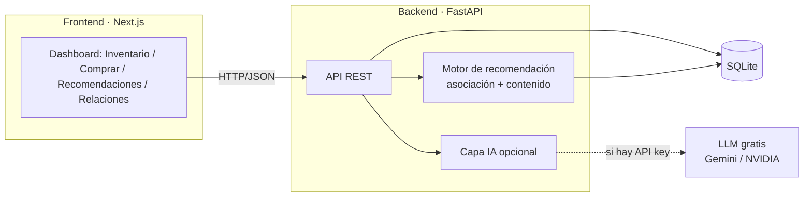

# Ferretería · Recomendador

Prueba técnica — Área de Innovación. El punto de partida del cliente fue:
*"subir las ventas con un sistema de recomendaciones"* para una ferretería con
5 tiendas (Cancún, Chihuahua, CDMX, Monterrey y Mérida) que comparten el mismo
inventario.

La solución es una POC completa: un backend que administra el inventario
compartido y recomienda **qué más llevar**, y un frontend para operar todo con
un selector de tienda. El recomendador no es una caja negra: el negocio puede
**ver** las relaciones que encuentra, **ajustarlas** y **medir** si son buenas.

- **Backend:** Python + FastAPI + SQLite (SQLAlchemy)
- **Frontend:** Next.js 14 (App Router) + TypeScript
- **IA (opcional):** explicación del combo con un LLM compatible con la API de
  OpenAI (Gemini / NVIDIA), con respaldo por plantilla si no hay clave.

---

## 1. Cómo levantarlo

### Backend

```bash
cd backend
python -m venv .venv
# Windows
.venv\Scripts\activate
# Linux / macOS
source .venv/bin/activate

pip install -r requirements.txt
uvicorn app.main:app --reload --port 8000
```

La base SQLite se crea y **se siembra sola** en el primer arranque, leyendo
`data/products.csv` y `data/sales.csv` (28 productos, 5 tiendas, 89 renglones de
venta). La documentación interactiva queda en <http://localhost:8000/docs>.

### Frontend

```bash
cd frontend
npm install
npm run dev
```

Abre <http://localhost:3000>. La URL del backend se toma de
`NEXT_PUBLIC_API_URL` (por defecto `http://localhost:8000`).

### Pruebas

```bash
cd backend
pytest
```

Nueve pruebas: anti-sobreventa (rollback de una compra con varios productos y
protección al eliminar un producto con ventas) y el recomendador (asociación,
filtro de stock, ocultar, y arranque en frío).

### IA opcional

Copia `backend/.env.example` a `backend/.env` y pon tu clave en `LLM_API_KEY`
(Gemini o NVIDIA; ambos son gratuitos y compatibles con la API de OpenAI). Si
dejas la clave vacía, la explicación se arma con una plantilla local y el
sistema arranca igual.

---

## 2. Qué hace

- **CRUD de productos** (crear, consultar, actualizar, eliminar).
- **Compra por tienda** que descuenta del **inventario compartido** y **nunca
  sobrevende**, venga de la tienda que venga.
- **Recomendador**: dado un producto y una tienda, propone qué más llevar, solo
  con productos que tienen existencia.
- **Panel de relaciones (negocio)**: muestra las relaciones descubiertas con sus
  métricas y permite **ocultarlas o impulsarlas**.
- **Evaluación**: mide qué tan buenas son las recomendaciones.

---

## 3. Arquitectura



El motor de recomendación se reconstruye en cada petición a partir de las ventas
en la base (con 28 SKUs es instantáneo). Esto tiene una ventaja: **cada compra
nueva alimenta de inmediato** las recomendaciones.

---

## 4. Decisiones de diseño

### Inventario compartido, a prueba de sobreventa

El inventario es **uno solo** para las 5 tiendas, así que el `stock` vive en el
producto. La compra descuenta con un **UPDATE condicional atómico**:

```sql
UPDATE products SET stock = stock - :cantidad
WHERE sku = :sku AND stock >= :cantidad
```

Si la sentencia afecta **0 filas**, es que no había existencia suficiente y se
aborta **toda** la compra (rollback). Al ser una sola sentencia, la verificación
y el descuento son atómicos: dos cajas que compren el último artículo al mismo
tiempo no pueden sobrevender. Una compra de varios productos es todo-o-nada.

### Recomendador híbrido (el corazón de la prueba)

Decidí un enfoque **híbrido y explicable**, no una caja negra:

1. **Reglas de asociación (market-basket)** sobre el historial de tickets, con
   métricas estándar e interpretables:
   - **soporte**(A,B): qué tan frecuente es el par,
   - **confianza**(A→B): de quienes llevan A, cuántos llevan B,
   - **lift**(A,B): cuánto más probable es B dado A frente al azar (>1 = relación real).

   Son interpretables a propósito: el negocio ve **por qué** se relacionan dos
   productos y puede ajustarlo.

2. **Respaldo por contenido** para el **arranque en frío**: un producto sin
   co-compras en el historial (p. ej. `SKU027`, que no aparece en ninguna venta)
   se relaciona por coincidencia de `uso_recomendado` y `material`. Lo mismo para
   una **tienda sin historial**: **Mérida** no tiene ventas en el dataset, así
   que cae en las reglas globales y, si hace falta, en el respaldo por contenido.

3. **Ponderación por tienda** proporcional a la evidencia: el bono es
   `1 + 0.5·(coocurrencias_en_la_tienda / (coocurrencias_en_la_tienda + 1))`
   (satura en 1.5×), de modo que una tienda con pocas ventas del par pesa menos
   que una con muchas. Más **filtro de existencia** (solo recomienda con stock)
   y **ajustes del negocio** (ocultar / impulsar un par).

**Robustez con pocos datos:** como el histórico es chico (89 ventas), un par
visto una sola vez puede dar un *lift* alto por azar. Por eso el **panel de
relaciones** solo muestra pares con **≥2 co-ocurrencias** (`min_count`, 2 por
defecto) y el **score** se pondera por evidencia con un *shrinkage*
`count/(count+1)` (1 vez → 0.5, 2 → 0.67), para que un par raro no domine. Los
productos sin pares fuertes caen al respaldo por contenido.

### ¿Cómo compruebo que las recomendaciones son buenas?

Con una evaluación **leave-one-ticket-out** (`GET /api/evaluation`): por cada
ticket, el modelo se **re-entrena sin ese ticket** (para no hacer trampa) y se
mide si, dado un producto del ticket, predice los demás. Resultados sobre el
dataset provisto:

| Métrica       | Modelo   | Línea base (popularidad) |
|---------------|----------|--------------------------|
| hit-rate@3    | **0.32** | 0.18                     |
| precision@3   | 0.14     | —                        |
| recall@3      | 0.29     | —                        |

El modelo casi **duplica** el hit-rate de recomendar "lo más vendido". Además, a
la línea base se le da una ventaja a propósito (ve todos los tickets), así que la
mejora es **conservadora**: aun con esa ventaja, el recomendador gana.

> El hit-rate se mide sobre los productos-semilla que tienen señal de asociación
> en el historial; un producto sin co-compras no entra en esta métrica (ahí
> actúa el respaldo por contenido).
>
> La **evaluación es un cálculo bajo demanda** (reentrena dejando fuera cada
> ticket); con 42 tickets es instantáneo. A escala se cachearía hasta que
> entren ventas nuevas.
>
> Sobre `precision@3 = 0.14`: el techo es bajo **por diseño del dato** — los
> tickets tienen 2–3 productos, así que si solo hay 1 producto-objetivo además
> de la semilla, el máximo posible de precision@3 es 0.33. Por eso el
> **hit-rate** y el **recall** describen mejor la utilidad aquí.

### Capa de IA (opcional, con respaldo)

`POST /api/recommendations/{sku}/explain` arma una frase para el cajero del tipo
*"quien lleva X suele completar el trabajo con Y y Z"* usando un LLM gratuito
(Gemini o NVIDIA, vía la API compatible con OpenAI). Si no hay clave, el
proveedor falla o está saturado, **degrada a una plantilla local** y nunca tumba
la petición.

---

## 5. Endpoints

| Método | Ruta | Descripción |
|--------|------|-------------|
| GET | `/api/stores` | Lista de tiendas |
| GET | `/api/products` · `/api/products/{sku}` | Consultar productos |
| POST | `/api/products` | Crear producto |
| PUT | `/api/products/{sku}` | Actualizar producto |
| DELETE | `/api/products/{sku}` | Eliminar producto |
| POST | `/api/purchases` | Comprar (descuenta inventario, 409 si no alcanza) |
| GET | `/api/recommendations/{sku}?store=&k=` | Recomendaciones |
| POST | `/api/recommendations/{sku}/explain` | Explicación en lenguaje natural (IA) |
| GET | `/api/rules` | Relaciones descubiertas (soporte/confianza/lift) |
| GET · POST · DELETE | `/api/overrides` | Ajustes del negocio (ocultar/impulsar) |
| GET | `/api/evaluation?k=` | Métricas de calidad del recomendador |

---

## 6. Qué dejaría para producción (lo honesto)

Esto es una POC; con más tiempo haría:

- **Autenticación y roles** (no la pedía la prueba).
- Precalcular el modelo con un job/caché en vez de reconstruirlo por petición
  (con 28 SKUs es instantáneo; a escala conviene precomputar o usar FP-Growth).
- Reglas más ricas: soporte mínimo, recencia y estacionalidad, y recomendación
  a nivel carrito (no solo producto-semilla).
- **Concurrencia real**: SQLite serializa escrituras; en PostgreSQL el mismo
  UPDATE atómico (o `SELECT ... FOR UPDATE`) escala sin cambiar la lógica.
- Medir **uplift real** con un A/B en tienda, no solo la métrica offline.

---

## 7. Estructura

```
ferreteria-recomendador/
├─ backend/
│  ├─ app/
│  │  ├─ main.py          # API FastAPI (CRUD, compra, recomendaciones, panel)
│  │  ├─ recommender.py   # asociación + contenido + evaluación
│  │  ├─ models.py        # tablas (inventario compartido)
│  │  ├─ schemas.py       # validación Pydantic
│  │  ├─ seed.py          # carga de los CSV
│  │  ├─ llm.py           # capa IA opcional
│  │  └─ database.py
│  ├─ data/               # products.csv, sales.csv
│  ├─ tests/              # pytest
│  └─ requirements.txt
└─ frontend/
   ├─ app/                # dashboard + componentes por pestaña
   └─ lib/                # cliente tipado de la API
```
